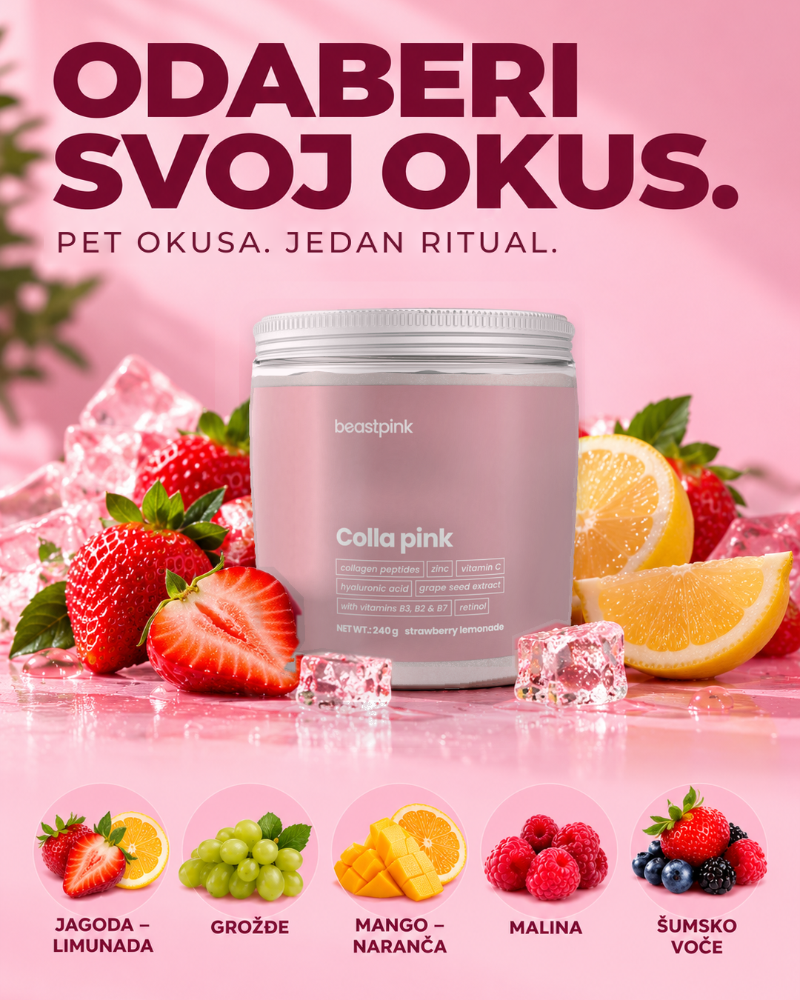

# AI Brand Content Studio

AI sustav koji od briefa brenda dolazi do gotovih Instagram objava: istražuje brend, planira sadržaj, generira slike i videe, provjerava kvalitetu i priprema isporuku. Portfolio projekt iz područja AI proizvoda: višeagentni tijek rada (LangGraph), stvarne integracije AI providera, kontrola troška i ljudsko odobrenje.

**Demonstracijski brend:** GymBeam Hrvatska ([@gymbeamhr](https://www.instagram.com/gymbeamhr/)).
Zamišljeni portfolio rad: osobe su fiktivne (generirane umjetnom inteligencijom) i ne radi se o službenoj suradnji s GymBeamom ni BeastPinkom.

> **Gotove objave su u [`showcase/`](showcase/)**: samo finalne, isporučene datoteke. Sadržaj je bajt po bajt identičan isporučenim datotekama (provjereno SHA-256, [manifest](showcase/README.md)). Međuverzije, sirovi AI izlazi i logovi nisu u gitu (`runs/` i `submission/*` su u `.gitignore`). Prije korištenja medija pročitaj [Prava na medije](#prava-na-medije).

---

## Final Campaign Deliverables

Što je sustav stvarno proizveo: tri Instagram objave za GymBeam Hrvatska, vidljive bez instalacije.

### Objava 1 – GymBeam Creatine Monohydrate · premium hero

<a href="showcase/post-01-creatine/"></a>

Statična slika 1080×1350, finalna verzija V5. Pravo pakiranje je izrezano iz službene fotografije i postavljeno kodom. Scena i čaša generirane su s `gpt-image-2.5-sunburst`, a naslov je iscrtan kodom. → [detalji i caption](showcase/post-01-creatine/)

### Objava 2 – BeastPink Colla Pink · karusel od 6 slajdova

| 1 | 2 | 3 ▶ video | 4 | 5 ▶ video | 6 |
|---|---|---|---|---|---|
|  |  | [](showcase/post-02-colla-pink/slide-3-preparation.mp4) |  | [](showcase/post-02-colla-pink/slide-5-beauty-drink.mp4) |  |

Edukativni lifestyle karusel 4:5 sa 4 slike i 2 videa od 5 s. Scene su generirane s `gpt-image-2.5-sunburst`, a prava teglica vraćena je kodom. Slajdovi 3 i 5 animirani su s Kling v4 (image-to-video). Sav tekst dodan je kodom, a tvrdnja o cinku prati Uredbu (EU) 432/2012. → [svi slajdovi, videi i caption](showcase/post-02-colla-pink/)

### Objava 3 – GymBeam Protein Wafer · lifestyle Reel

<a href="showcase/post-03-protein-wafer/protein-wafer-reel.mp4"></a>

**▶ [Reel FINAL V8 (MP4, 1080×1920, 8,83 s, sa zvukom)](showcase/post-03-protein-wafer/protein-wafer-reel.mp4)** · [naslovnica (9:16)](showcase/post-03-protein-wafer/reel-cover-9x16.png)

UGC priča „kuhinja → torba → auto → teretana". Uključuje 14 keyframeova (`gpt-image-2.5-sunburst`, prema službenim fotografijama wafera i torbe) i 5 Kling klipova. Montaža je u rough-cut stilu, uz sintetizirani foley. V8 je odabran nakon odbijenih verzija V4–V7. → [kadrovi, caption i ograničenja](showcase/post-03-protein-wafer/)

---

## Tri gotove objave

| # | Objava | Format | Kako je nastala | Skripte u repou |
|---|---|---|---|---|
| 1 | **GymBeam 100% Kreatin Monohidrat – hero** „Svaka serija počinje odlukom." | slika 1080×1350 | pravo pakiranje sa službene fotografije (izrez i postavljanje kodom); scena s mokrim škriljevcem i čašom generirana s `gpt-image-2.5-sunburst` (maskirano uređivanje); naslov dodan kodom | `plans/gymbeam_hr/art_direction/hero_proof/` |
| 2 | **BeastPink Colla Pink – karusel** „Vaš ružičasti ritual" | 6 slajdova 1080×1350: 4 slike + 2 videa (5 s) | scene generirane s `gpt-image-2.5-sunburst`, prava teglica vraćena kodom; slajdovi 3 i 5 animirani s Kling v4 (image-to-video); sav tekst na slajdovima i videima dodan kodom | `plans/gymbeam_hr/phase5/` |
| 3 | **GymBeam 32% Protein Wafer – lifestyle Reel** (V8) | video 1080×1920, 8,83 s, sa zvukom | 14 keyframeova (`gpt-image-2.5-sunburst`, prema službenim fotografijama wafera i torbe Urban Duffle), 5 Kling klipova od 3 s, montaža u rough-cut stilu, sintetizirani zvuk i naslovnica B | `plans/gymbeam_hr/phase6/reel/` |

### Gdje je točno što

**Objava 1 – hero** (`plans/gymbeam_hr/art_direction/hero_proof/`)
- `make_hero.py` – generiranje scene oko zaštićenog platna s pravim pakiranjem
- `cutout.py`, `hero_v2.py` – izrez vrećice sa službene fotografije i postavljanje uz ograničeno usklađivanje svjetla
- `glass_edit.py` – jedno plaćeno maskirano uređivanje: čaša pored vrećice
- `glass_closer.py` – besplatan lokalni pomak čaše (verzija V5)
- `preview_clean.py` – tipografija naslova (Inter)
- zapisi: `plans/gymbeam_hr/hero_package/`

**Objava 2 – karusel** (`plans/gymbeam_hr/phase5/`)
- naslovnica: `cover_slide1_v2.py`, `retouch_cover2.py`, `cover_layout_v2.py`
- slajdovi 2 i 4: `carousel_rest.py`, `jar_matte.py`, `slide2_remove_footer.py`
- slajd 3 (video „Priprema"): `slide3_video_prep.py` → `slide3_video_generate.py` (Kling) → `slide3_final_v3.py`
- slajd 5 (video „Napitak za ljepotu"): `slide5_video_prep.py`, `slide5_hair_calm.py` → `slide5_video_generate_v2.py` (Kling) → `slide5_final_v4.py` (tvrdnja o cinku prema Uredbi 432/2012)
- slajd 6: `slide6_final.py`, `slide6_color_fix.py`, `slide6_harmonize.py`, `slide6_cleanup.py`
- pregled svih slajdova: `final_contact_sheet_v4.py`
- brief, dokazi i odluke: `PHASE5_CAROUSEL_BRIEF.md`, `colla_pink_brief.md`, `colla_pink_assets.yaml`

**Objava 3 – Reel** (`plans/gymbeam_hr/phase6/reel/`)
- keyframeovi: `gen_keyframe.py`, `gen_keyframe_S03B.py`
- video klipovi: `run_kling.py`, `run_kling_S03B.py` (fal.ai `fal-ai/kling-video/v4/image-to-video`)
- montaža konačne verzije: `assemble_reel_v8_candidate.py` (+ `reel_lib.py`)
- zvuk: `foley.py` · naslovnica: `cover_wrapper_fix.py`
- plan, odluke i QA: `REEL_PRODUCTION_PLAN_v3.md`, `FINAL_QA_REPORT.md`, `CONTINUITY_CHECKLIST.md`, `SOURCE_LEDGER.md`

**Konačni plan i usklađenost** (`plans/gymbeam_hr/final_revision/`)
- `CONTENT_PLAN_FINAL_REVISION.md` (R9) – točno tri predane objave, uz hashove datoteka
- `FINAL_SCOPE_REVISION_7F.md` – kako je opseg prešao s briefa samo za kreatin na tri proizvoda
- `ZINC_CLAIM_432_2012_HR.md`, `SLIDE5_CLAIM_REVIEW.md`, `POST2_FACT_CHECK_7F.md` – provjera zdravstvenih tvrdnji i činjenica
- `CAPTION_CHANGES_7F.md`, `HASHTAG_CHECK_7F.md`, `ALT_TEXT_HR.md` – opisi, hashtagovi i alt tekstovi

---

## Kako sustav radi (faze)

```
brief → istraživanje → analiza brenda → plan → [ljudsko odobrenje] → produkcija → QA → [ljudsko odobrenje] → isporuka
```

| Faza | Što radi | Gdje |
|---|---|---|
| Brief | interaktivna pitanja (web, proizvodi, publika, ciljevi, uzori) → `brief.yaml` | `studio brief`, `briefs/gymbeam_hr.yaml` |
| Istraživanje | agent (Claude Haiku 5.5) s alatima za web i Instagram (Apify, 30 objava) | `studio/nodes/research_live.py`, `research/` |
| Analiza brenda | profil brenda i registar dokaza: svaka tvrdnja ima izvor, oznaku „provjereno" ili „pretpostavka" | `studio/nodes/analyst_live.py`, `research/gymbeam_hr_agent/` |
| Plan | Claude Sonnet 5.5, strukturirani izlaz (shema `CampaignPlan/2`), validator tvrdnji, ljudske izmjene kroz `studio plan edit` | `studio/strategy/`, `plans/gymbeam_hr/content_plan.json` |
| Produkcija | slike (`gpt-image-2.5-sunburst`), video (Kling v4), kompozicija pravog proizvoda, tipografija i montaža kodom | `plans/gymbeam_hr/art_direction/`, `phase5/`, `phase6/` |
| QA i isporuka | provjere formata, vjernosti proizvoda, tvrdnji; pregled kadar po kadar; paket s hashovima | `studio/nodes/gates.py`, `plans/gymbeam_hr/phase7/` |

**Infrastruktura:** LangGraph s SQLite checkpointerom (nastavak nakon prekida), fingerprint cache (ponavljaju se samo faze čiji su se ulazi promijenili), operation ledger i spend guardovi (tvrdi proračun, ograničenje broja zahtjeva, bez automatskih ponavljanja), odobrenja vezana uz hash artefakta, mock provideri za testove bez API-ja.

**Načela:**
- Pravi proizvod se ne generira kada postoji službena fotografija: na heru i u karuselu pakiranje su pikseli službene fotografije. U Reelu su wafer i torba (stvarni proizvodi s gymbeam.hr) generirani prema službenim fotografijama, jer se proizvod u videu pomiče.
- Sav vidljivi tekst na slikama i videima dodaje se kodom, ne generira ga model.
- Svaka brojka ima izvor; zdravstvene tvrdnje samo u odobrenoj formulaciji.
- Čovjek odobrava plan i završne verzije; odbijeni pokušaji i razlozi su zapisani.

---

## Pokretanje

Testirano na Windowsu 10/11 s Pythonom 3.12 (i 3.14). macOS/Linux nisu testirani.

```powershell
py -3.12 -m venv .venv
.\.venv\Scripts\python.exe -m pip install -e ".[dev,media]"
.\.venv\Scripts\python.exe -m pytest                       # 247 prolazi, 2 preskočena (trebaju službenu fotografiju)
$env:STUDIO_NO_DOTENV = "1"
.\.venv\Scripts\studio.exe run --mock                      # test arhitekture s mock providerima
```

> `studio run --mock` proizvodi **placeholdere** (jednobojne slike i JSON) kako bi se testirao tijek rada. To **nisu** objave.

**Ponovno sastavljanje sve tri stvarne objave** (lokalno, besplatno, bez API ključeva) radi se iz arhivskog paketa projekta koji sadrži sirove AI izlaze (nije u ovom repozitoriju), skriptom `tools/REPRODUCE_SVE_TRI_OBJAVE_7F.ps1`.

**Nova AI generacija** traži vlastite ključeve (`.env` prema `.env.example`: `ANTHROPIC_API_KEY`, `OPENAI_API_KEY`, `FAL_KEY`, `APIFY_TOKEN`) i podizanje limita u skriptama, jer su ih originalni pokreti potrošili. Rezultat su nove, drukčije slike, a ocjenjuju se istim QA pravilima.

---

## Trošak

| Stavka | USD |
|---|---|
| Tekstualni modeli (istraživanje + plan) | 0,53 (potvrđeno) |
| Slike (hero, karusel, Reel) | 2,80 (potvrđeno) |
| Video, Kling | ≈ 7,06 (procjena po cijeni po sekundi) |
| **Ukupno** | **≈ 10,39** |

---

## Struktura repozitorija

```
showcase/          tri finalne objave (slike, karusel, Reel MP4) s opisima
studio/            aplikacija: CLI, LangGraph graf, čvorovi, ugovori (Pydantic), provideri, ledger, promptovi
plans/gymbeam_hr/  plan, povijest odluka i skripte koje su napravile objave (hero, karusel, Reel, pakiranje)
research/          istraživanje: izvori, uvozi, Instagram izvoz
briefs/            brief brenda
tests/             pytest testovi
docs/              arhitektura
config.yaml        modeli, limiti, cijene
.env.example       primjer konfiguracije bez ključeva
WORKLOG.md         dnevnik rada po fazama
```

## Prava na medije

- **Nekomercijalni portfolio prikaz.** Objave su zamišljeni (spekulativni) oglasi. Nisu službena suradnja s GymBeamom ni BeastPinkom, brendovi ih nisu naručili ni odobrili i nisu namijenjene oglašavanju.
- **Zaštitni znakovi** GymBeam i BeastPink, nazivi proizvoda i dizajn pakiranja vlasništvo su njihovih nositelja.
- **Službene fotografije:** u objavama 1 i 2 pakiranje je izrezano iz službenih fotografija proizvoda. U objavi 3 wafer i torba su AI renderi izrađeni prema službenim fotografijama. **Dopuštenje nositelja prava za objavu tih fotografija nije pribavljeno.** Na zahtjev nositelja prava mediji će biti uklonjeni.
- **Osobe** u objavama su fiktivne i generirane umjetnom inteligencijom.
- Zdravstvene tvrdnje i hrvatski tekst nisu prošli pravni pregled ni lekturu izvornog govornika.

## Ograničenja

- Plaćeni koraci (agent, plan, slike, Kling) nisu ponovljivi bit po bit.
- U Reelu je sitni tekst na omotu u pokretu mekši nego na fotografiji, a lice osobe blago varira između kadrova.
