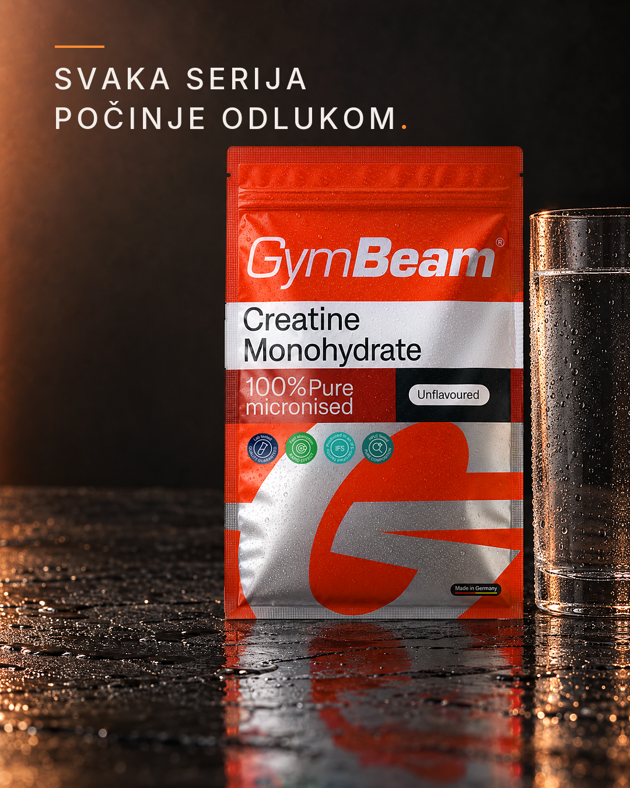
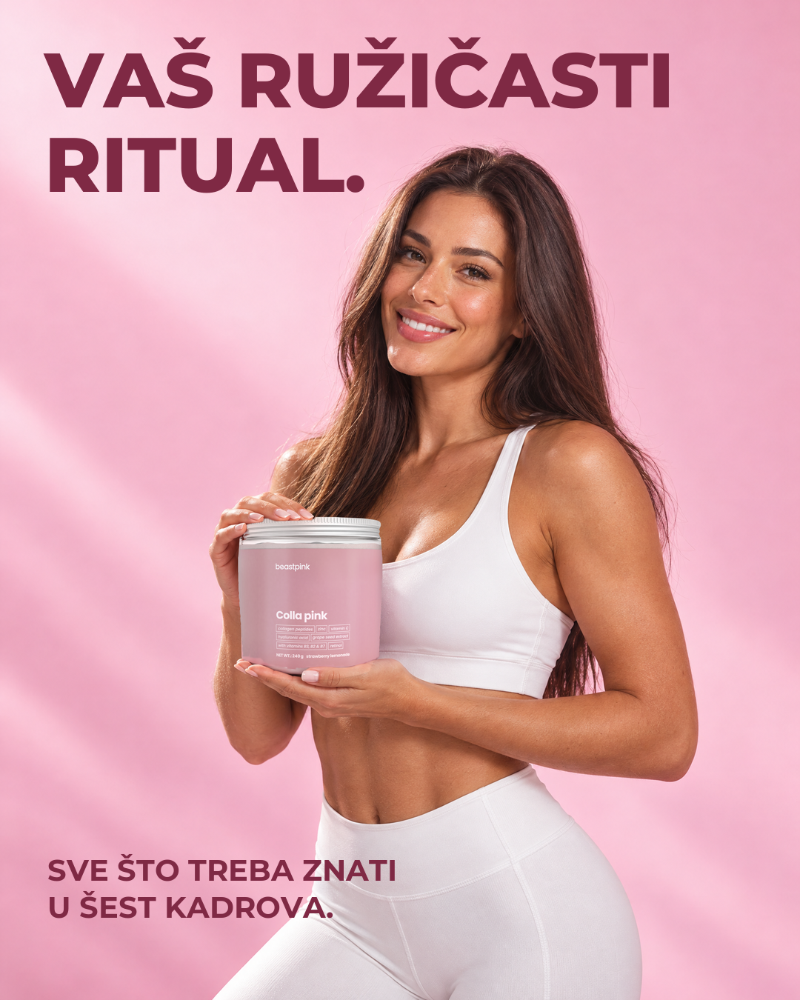
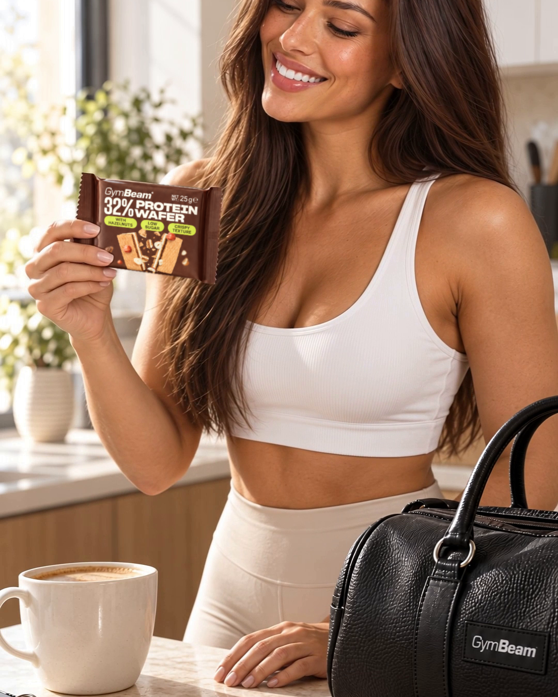
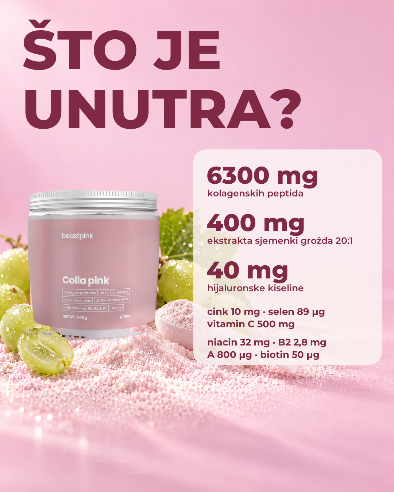
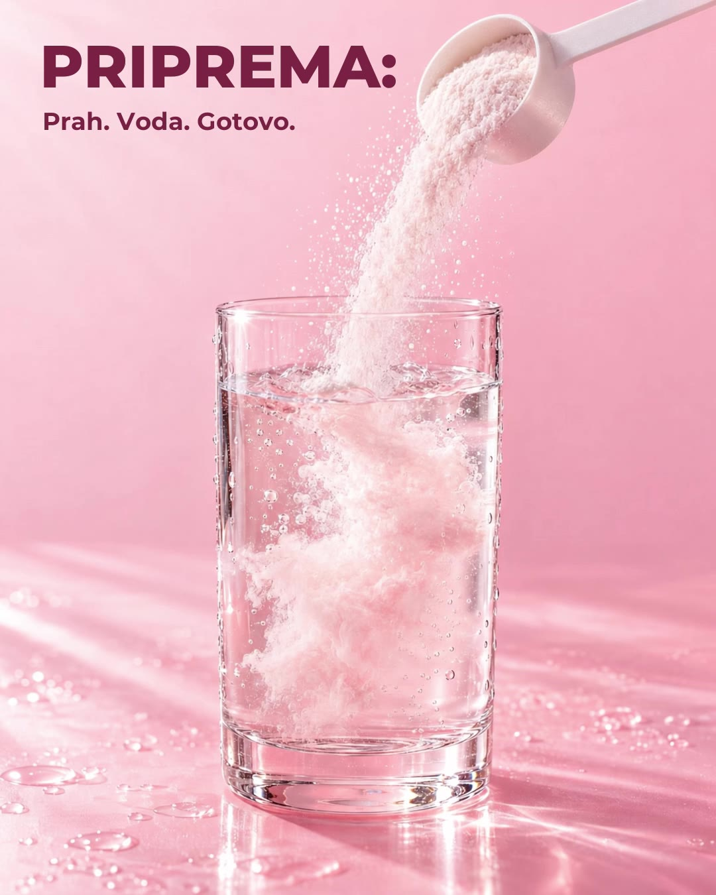
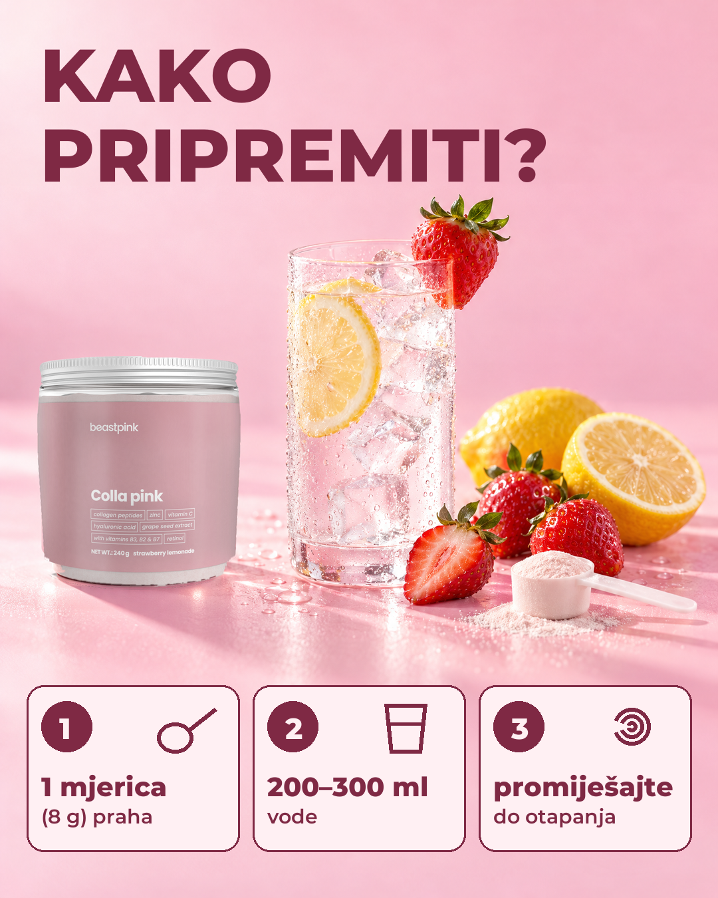
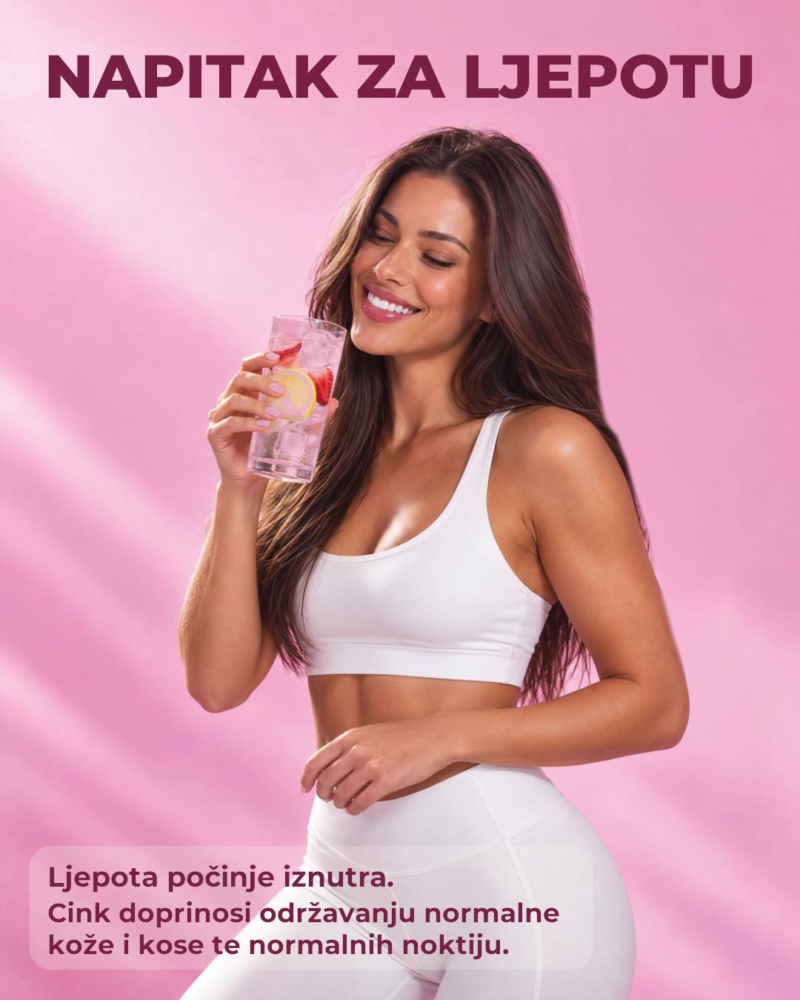
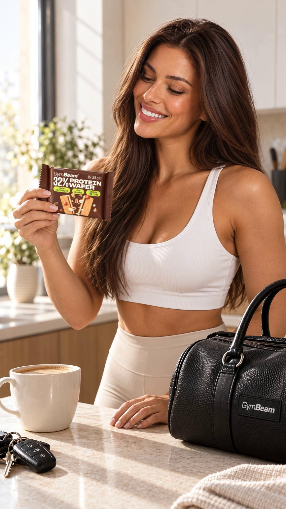
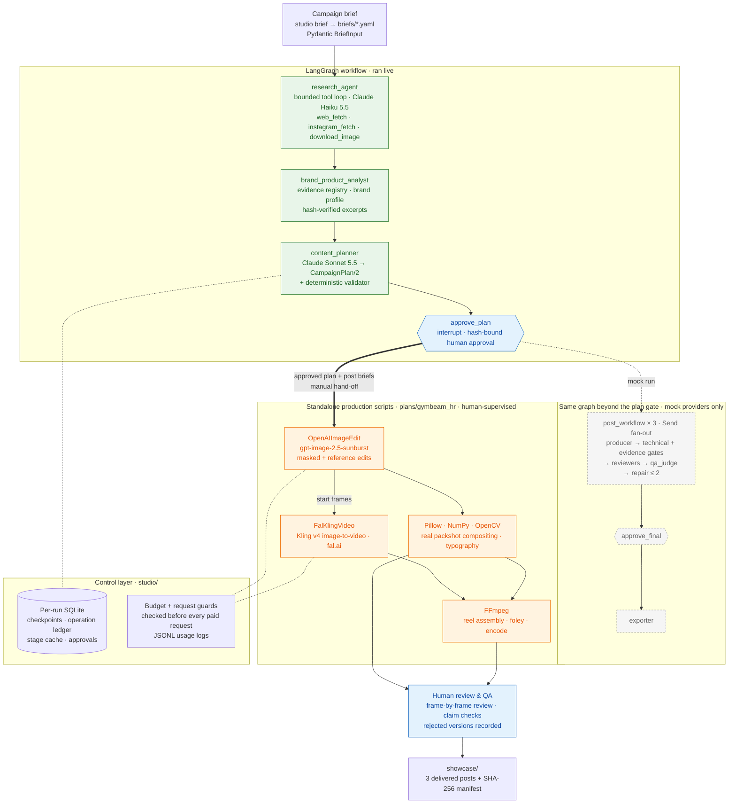

<div align="center">

# AI Brand Content Studio

**From a brand brief to finished Instagram posts: tool-using research with verifiable evidence, schema-validated campaign planning with human approval, generative image and video production under hard spend limits, and a delivery you can re-assemble deterministically.**

[](https://github.com/KrzakLara/AI_Brand_Content_Studio/actions/workflows/no-claude-files.yml)


[Final Deliverables](#final-campaign-deliverables) · [Architecture](#system-architecture) · [AI Workflow](#ai-workflow) · [Testing](#testing--verification) · [Engineering Decisions](#engineering-decisions--trade-offs) · [Limitations](#limitations--next-steps) · [Quick Start](#quick-start)

</div>

AI Brand Content Studio turns a brand brief into publishable social content and keeps every step auditable. A bounded, tool-using research agent collects brand and product facts from the live web shop, and every fact is stored with its source and content hash. A Claude model then plans a three-post campaign as schema-validated JSON, and a deterministic validator rejects any claim it cannot trace to evidence. Media is produced with OpenAI image editing and Kling image-to-video, with real product packshots composited in code. From an engineering point of view, the interesting part is the control layer around the models: LangGraph checkpoints, an idempotent operation ledger, budget guards that run before every paid request, approvals bound to content hashes, and a test suite that runs with sockets blocked.

> **Status:** a portfolio project with real outputs. The research and planning stages ran live through the LangGraph workflow. The three final posts were produced by **standalone, human-supervised production scripts** that use the same provider adapters and ledger. The full end-to-end graph (production → QA → export) has been run **only with mock providers**. See [What is automated and what is not](#what-is-automated-and-what-is-not).
>
> ⚠️ **Media publication rights: UNRESOLVED.** Posts 1 and 2 contain cut-outs of official brand product photographs, and Post 3 contains AI renders based on them. Permission from the rights holders has not been obtained. This is an unofficial, non-commercial portfolio project. See [Media Rights & Disclaimer](#media-rights--disclaimer).

---

## Final Campaign Deliverables

Three finished Instagram posts for the Croatian market (demonstration brand: GymBeam Croatia, [@gymbeamhr](https://www.instagram.com/gymbeamhr/)). The files in [`showcase/`](showcase/) are byte-identical to the delivered finals ([SHA-256 manifest](showcase/README.md)). On-image copy is in Croatian. All visible text was rendered in code, not by an image model.

<table>
<tr>
<th width="33%">1 · Hero image</th>
<th width="33%">2 · Carousel, 6 slides</th>
<th width="33%">3 · Lifestyle Reel</th>
</tr>
<tr>
<td align="center"><a href="showcase/post-01-creatine/"></a></td>
<td align="center"><a href="showcase/post-02-colla-pink/"></a></td>
<td align="center"><a href="showcase/post-03-protein-wafer/protein-wafer-reel.mp4"></a></td>
</tr>
<tr>
<td align="center"><b>GymBeam Creatine Monohydrate</b><br>image, 1080×1350<br><a href="showcase/post-01-creatine/">View post →</a></td>
<td align="center"><b>BeastPink Colla Pink</b><br>4 images + 2 videos, 1080×1350<br><a href="showcase/post-02-colla-pink/">View all 6 slides →</a></td>
<td align="center"><b>GymBeam Protein Wafer</b><br>video 1080×1920, 8.83 s, with audio<br><a href="showcase/post-03-protein-wafer/protein-wafer-reel.mp4"><b>▶ Watch Final Reel (MP4)</b></a></td>
</tr>
</table>

### Post 1 · GymBeam Creatine Monohydrate · premium hero

<a href="showcase/post-01-creatine/"></a>

| Stage | How it was made |
|---|---|
| Product | Pouch **cut out of the official product photo** and placed in code with constrained light matching. The model never drew the packaging. |
| Scene | Wet slate and glass generated by `gpt-image-2.5-sunburst` through **masked edits around a protected product canvas**. Then one paid mask edit placed the glass, and a free local shift produced V5. |
| Typography | Headline (human-written) rendered with Pillow in Inter. |
| Selection | V1–V5 reviewed, V5 chosen by hand. Image cost 0.28 USD (2 paid images). |

Scripts: [`plans/gymbeam_hr/art_direction/hero_proof/`](plans/gymbeam_hr/art_direction/hero_proof/) · Records: [`plans/gymbeam_hr/hero_package/`](plans/gymbeam_hr/hero_package/) · Post page: [`showcase/post-01-creatine/`](showcase/post-01-creatine/)

### Post 2 · BeastPink Colla Pink · educational carousel

| 1 · Cover | 2 · Ingredients | 3 · Preparation ▶ | 4 · How to prepare | 5 · Beauty drink ▶ | 6 · Flavours |
|:-:|:-:|:-:|:-:|:-:|:-:|
|  |  | <a href="showcase/post-02-colla-pink/slide-3-preparation.mp4"></a> |  | <a href="showcase/post-02-colla-pink/slide-5-beauty-drink.mp4"></a> |  |
| image | image | [▶ MP4](showcase/post-02-colla-pink/slide-3-preparation.mp4) | image | [▶ MP4](showcase/post-02-colla-pink/slide-5-beauty-drink.mp4) | image |

| Stage | How it was made |
|---|---|
| Image generation | Scenes generated by `gpt-image-2.5-sunburst`. The **real jar was restored in code** from the official photo (matte + placement). |
| Video generation | Slides 3 and 5 animated with **Kling v4 image-to-video** (fal.ai) from a clean start frame. The first slide-5 clip was rejected (wind-blown hair), and the start frame was calmed locally before the single regeneration. |
| Compositing | Text burned onto every frame in code. Slide 2 footer removed locally, and slide 6 had three artifacts retouched locally (no paid calls). |
| QA | The zinc claim on slide 5 uses the exact authorised wording of Regulation (EU) 432/2012 (official Croatian text). The fact check and claim review are in [`final_revision/`](plans/gymbeam_hr/final_revision/). |

Scripts: [`plans/gymbeam_hr/phase5/`](plans/gymbeam_hr/phase5/) · [Carousel overview](showcase/post-02-colla-pink/carousel-overview.png) · Post page: [`showcase/post-02-colla-pink/`](showcase/post-02-colla-pink/)

### Post 3 · GymBeam Protein Wafer · lifestyle Reel

<a href="showcase/post-03-protein-wafer/protein-wafer-reel.mp4"></a>

### [▶ Watch Final Reel (MP4)](showcase/post-03-protein-wafer/protein-wafer-reel.mp4)

V8 · 1080×1920 · 8.83 s (212 frames, 24 fps) · H.264 + AAC. If the browser does not play it inline, use *View raw* or *Download*.

| Stage | How it was made |
|---|---|
| Keyframes | 14 keyframes from `gpt-image-2.5-sunburst`, conditioned on the official wafer and Urban Duffle bag photos. |
| Video | 5 Kling v4 image-to-video clips of 3 s each (fal.ai), each one a single paid submit with no automatic resubmission. |
| Assembly | Story "kitchen → bag → car → gym", deliberately cut in a rough-cut UGC style. Edit, synthesised foley and cover are **deterministic Python + FFmpeg** scripts. Re-assembly reproduces identical decoded frames. |
| QA | V4–V7 were rejected or superseded (for example, V4 for a deformed bag handle, fixed with one new keyframe and one Kling clip). V8 was chosen after a visual review. |

Scripts and QA: [`plans/gymbeam_hr/phase6/reel/`](plans/gymbeam_hr/phase6/reel/) (final edit: `assemble_reel_v8_candidate.py`) · Post page: [`showcase/post-03-protein-wafer/`](showcase/post-03-protein-wafer/)

---

## The Problem

Producing on-brand content with generative models fails in predictable ways:

- **Unreliable product facts.** LLMs paraphrase or invent ingredients, quantities and health claims. In the EU, health claims on food supplements must match authorised wording.
- **Brand consistency.** Models do not know a brand's palette, voice, banned phrases or packaging, and they redraw logos and label text incorrectly.
- **Inconsistent visuals.** Faces, hands, product geometry and small print drift between generations and between video frames.
- **Fragmented workflows.** Research, copy, images, video and editing live in separate tools with no shared state, provenance or audit trail.
- **Human review.** Approvals made in chat or by eye are not tied to the exact artifact version that was approved.
- **Reproducibility.** Paid generations are non-deterministic, so "re-running the pipeline" produces a different campaign.
- **Cost and retries.** A naive retry on a timeout can pay twice for the same image or video, and token costs are only known after the call.
- **Quality assurance.** Format, aspect ratio, claim and continuity errors are easy to miss in a manual review.

## The Solution

| Problem | Engineering approach | Type |
|---|---|---|
| Unreliable product facts | Evidence registry: a fact is `verified` only if its excerpt is **re-found in the stored source whose SHA-256 still matches**. Operator observations are `manual`, and model inferences are `assumption`. Plans cite evidence IDs. | implemented, tested |
| Unsafe claims | Deterministic plan validator (`studio/strategy/validate.py`) blocks untraceable claims and health/performance statements. The final zinc wording was checked by hand against Regulation (EU) 432/2012. | validator implemented. Final claim check manual |
| Brand consistency | Brand profile with palette, fonts and banned phrases. The evidence gate rejects banned phrases. Real packshots are composited from official photos, and **all on-image text is rendered in code**. | gate implemented. Compositing per-post scripts |
| Inconsistent visuals | Masked edits around a protected product canvas, reference-image conditioning, and frame-by-frame review of each version, with rejected versions recorded. | production practice, manual review |
| Fragmented workflow | One LangGraph engine for research → analysis → plan → approval, and a mock-tested extension through production → QA → export, with per-run SQLite state. | implemented. Production branch mock-only |
| Human review | `interrupt()` gates whose approvals are **bound to the artifact's content hash**. Editing the plan invalidates the old approval, and plan edits are exact-match, atomic and audited. | implemented, tested |
| Reproducibility | Paid generation is separated from deterministic assembly. Archived raw AI outputs re-assemble the delivered posts offline, checked by SHA-256 or decoded frames. | tooling implemented. Archive not in this repo |
| Cost and duplicate calls | Operation ledger (`pending` before the call, `done` after) keyed by idempotency key. Paid providers are `safe_to_retry=False`. A worst-case budget check runs before **every** HTTP request, with request caps that persist across restarts. | implemented, tested with recorded transports |
| Quality assurance | Deterministic technical and evidence gates, parallel reviewers, a QA judge with a capped repair loop (escalation to a human is a fixed rule). Final media QA was done by hand. | gates/judge mock-tested. Final QA manual |

---

## What is automated and what is not

| Layer | Status | Where |
|---|---|---|
| **Research workflow** (LangGraph): bounded research agent + brand/product analyst | **ran live** (Claude Haiku 5.5 agent, live HTTP to gymbeam.hr), results in repo | `studio/nodes/research_live.py`, `analyst_live.py`, [`research/`](research/) |
| **Planning workflow** (LangGraph): content planner → human plan gate → revise / edit / export | **ran live** (Claude Sonnet 5.5, 3 message requests), approved plan in repo | `studio/strategy/`, `studio/nodes/planner_live.py`, [`plans/gymbeam_hr/`](plans/gymbeam_hr/) |
| **Full graph** beyond the plan gate: per-post producers → gates → reviewers → judge → repair → final approval → export | implemented and tested **with mock providers only** (placeholder images/JSON) | `studio/graph.py`, `studio/nodes/post_workflow.py` |
| **Media production**: image/video generation, compositing, typography, editing | **standalone scripts**, run step by step with human approval, using `studio`'s adapters and ledger | `plans/gymbeam_hr/art_direction/`, `phase5/`, `phase6/` |
| **Delivery & reproduction**: hash manifests, offline re-assembly, smoke tests | scripts implemented. The archive they run on is not published | `plans/gymbeam_hr/phase7/`, `tools/` |
| **Web layer**: FastAPI service and UI | **not implemented** (placeholder folders only) | `api/`, `web/` |

---

## Key Features

Each row was checked against the code on `main`.

| Area | Implemented |
|---|---|
| **Structured brief** | `studio brief` writes a validated `BriefInput` YAML (website, products, audience, goals, references) |
| **Bounded research agent** | LLM chooses one tool per step (`web_fetch`, `instagram_fetch`, `download_image`). Caps on steps, fetches, bytes and USD. Unknown tools, missing arguments and duplicate calls are refused and traced. A deterministic `ScriptedResearchPolicy` exists and is labelled non-autonomous. |
| **Safe HTTP layer** | All network access goes through one `Transport`, with a host allowlist, robots.txt (unreachable robots → fetch nothing), size limits and bounded backoff on 429/5xx. Fetched text is wrapped as `<untrusted_data>`, and injection phrases are flagged. |
| **Brand & product evidence** | `brand_profile.json`, `evidence_registry.json`, `source_index.json`, each item with origin (`live` / `manual_import` / `fixture` / `mock`) and hash-checked verification |
| **AI-assisted campaign planning** | Claude Sonnet 5.5 returns a `CampaignPlan/2` through a single client-side `respond` tool whose input schema is the Pydantic model. Truncated (`max_tokens`) or refused answers are discarded, never parsed. |
| **Pydantic contracts** | Brief, research, strategy, planning and runtime contracts (`studio/contracts/`). Ledger, artifact and approval records are typed. |
| **Plan validation & human editing** | Deterministic validator (errors block, flags go to the reviewer). `studio plan review / approve / reject / revise / edit / export`. Edits are exact-match, atomic, validated and appended to an audit history. |
| **LangGraph orchestration** | Parent `StateGraph` with `Send` fan-out to a compiled per-post subgraph, dict-merge reducers so parallel branches can't overwrite each other, `interrupt()` gates, `SqliteSaver` checkpoints (`thread_id == run_id`). |
| **Stage cache & partial redo** | Fingerprint of only the inputs a stage reads, plus prompt version and provider identity. `--from STAGE` and `--post NN` bump a generation counter, so a forced redo is a new operation, never a silent replay. |
| **Image generation adapter** | `OpenAIImageEdit`: masked or reference-image edits on `/v1/images/edits`, actual cost from the response `usage` block, worst-case guard `max(assumed, 1.5 × largest cost seen)` |
| **Video generation adapter** | `FalKlingVideo`: Kling v4 image-to-video via the fal.ai queue. One paid submit. Polling and download are free and never resubmit. |
| **Python media compositing** | Packshot cut-out and matting, light matching, retouching and typography (Pillow, NumPy, OpenCV) |
| **FFmpeg assembly** | Reel and carousel-video assembly, synthesised foley, H.264/AAC encode (`imageio-ffmpeg`) |
| **QA & verification** | Technical gate (file exists, SHA-256, PNG size, 4:5, video 5–60 s, slide counts), evidence gate (claim ↔ evidence text, banned phrases, mock labels), reviewer + judge loop, per-post QA reports for the real media |
| **Cost tracking & request budgets** | Per-run ledger with estimated or actual cost. JSONL usage logs replayed on start-up, so request and USD caps hold across process restarts. A transport-level `GuardedTransport` adds an independent request cap. |
| **Checkpointing & recovery** | A crash mid-call leaves the op `pending`, which becomes `unknown` on resume. Retry-safe (mock) providers re-run, and paid providers raise `NeedsReconciliation`. |
| **Automated testing** | 249 pytest tests. All outbound sockets are blocked by an autouse fixture, and an AST scan enforces that only `studio/tools/transport.py` may import network modules. |

---

## System Architecture

The diagram separates the three execution paths that actually exist. Solid green ran live. Dashed grey is the mock-tested part of the same graph. Orange is the standalone production path that made the published media.



**Why there are two paths.** The graph's production nodes call generic `ImageProvider.generate()` / `VideoProvider.generate()` protocols. The real adapters (`OpenAIImageEdit.edit()`, `FalKlingVideo.generate_from_image()`) have different, richer interfaces (masks, reference images, start/end frames) and are **not wired into the graph**. The production scripts call them directly, but still wrap paid calls in the same `OperationRunner` (idempotency key + ledger) and budget guards. Design notes: [`docs/ARCHITECTURE.md`](docs/ARCHITECTURE.md).

---

## AI Workflow

```
brief → research → brand analysis → plan → [human approval] → production → QA → [human approval] → delivery
```

| Phase | What runs | Model / provider | Control mechanisms | Automation boundary |
|---|---|---|---|---|
| **Brief** | `studio brief`: interactive questions → validated YAML | none | Pydantic `BriefInput` | human-authored |
| **Research** | `research_agent` loop: the model picks the next tool call, the runtime executes it | Claude Haiku 5.5 (recorded run: 5 steps, 0.0022 USD of a 0.03 USD cap) | step / fetch / byte / USD caps, request cap, allowlist, robots.txt, untrusted-data framing | **the only autonomous agent** in the system |
| **Brand analysis** | `brand_product_analyst`: source index → evidence registry → brand profile | deterministic in the recorded runs (`analysis_mode: heuristic_only`). An LLM tone-analysis path exists. | evidence `verified` only if re-found in the hash-matched artifact | deterministic step |
| **Planning** | `content_planner`: one structured-output call per plan/revision, then `validate.py` | Claude Sonnet 5.5 (`CampaignPlan/2`) | schema-shaped tool call, deterministic validator, plan hash | single LLM step, **not** an agent loop |
| **Approval** | `approve_plan` → `interrupt()`; `studio plan edit / approve / revise` | none | approval bound to the plan's content hash | human gate |
| **Production** | per-post scripts: generate → composite → typeset → assemble | `gpt-image-2.5-sunburst`, Kling v4 (fal.ai) | per-script USD + request caps, idempotency keys, no automatic resubmits | human-driven, script by script |
| **QA** | in-graph: technical + evidence gates, reviewers, judge. Real media: QA reports, continuity checklist, claim review | mocks in-graph. Humans for the real posts | max 2 repairs, then fixed-rule escalation | in-graph QA mock-tested. Final QA manual |
| **Delivery** | hash manifests, offline re-assembly, smoke tests | none | SHA-256, decoded-frame comparison, offline network guard | deterministic |

**Where the "agentic" behaviour really is:** only the research agent runs a model-driven loop. The planner, reviewers and QA judge are structured LLM *steps* with fixed inputs and outputs. Gates, escalation, approvals and export are plain Python. The first live research attempts failed. Free-text JSON did not parse, and because the prompt never listed the tools, the model invented tool names; the runtime refused them and the run ended with `ResearchFailed`. The failed run is kept in [`research/gymbeam_hr_agent_attempt1_failed/`](research/gymbeam_hr_agent_attempt1_failed/), and the fixes are covered by `tests/test_agent_failure.py`.

**Data provenance:** the Instagram reference posts were collected by the operator at development time through an Apify actor and imported with provenance (`ManualImportInstagram`). The runtime `ApifyInstagram` adapter has only run against test fixtures ([details](docs/instagram_collection.md)).

---

## Technology Stack

| Layer | Technologies |
|---|---|
| Language & packaging | Python 3.12 (also run on 3.14), setuptools, `studio` console entry point |
| Orchestration | LangGraph ≥ 1.0 (`StateGraph`, `Send`, `interrupt`), `langgraph-checkpoint-sqlite` |
| Contracts & validation | Pydantic v2, PyYAML, a deterministic plan validator |
| LLM | Anthropic Messages API: Claude Haiku 5.5 (research agent), Claude Sonnet 5.5 (planning). Own stdlib HTTP adapter, no vendor SDK. |
| Image generation | OpenAI Images edits API, `gpt-image-2.5-sunburst` (xhigh) |
| Video generation | Kling v4 image-to-video through the fal.ai queue API |
| Research sources | gymbeam.hr through the studio's own HTTP client. Instagram via an Apify actor (operator-run) and a provenance-checked YAML import. |
| Media processing | Pillow, NumPy, OpenCV (headless), FFmpeg via `imageio-ffmpeg`, ReportLab (methodology PDF) |
| Storage | One SQLite file per run (checkpoints, ledger, stage cache, approvals), JSONL usage logs, filesystem artifacts referenced by SHA-256 |
| Testing & CI | pytest (249 tests), socket-blocking fixture, AST network guard, recorded HTTP transports. GitHub Actions runs a repository-hygiene check. |
| API / UI | **not implemented**: `api/` and `web/` are placeholders |

---

## Testing & Verification

**249 tests collected, 249 passed** on 2026-11-17 (Windows 10, Python 3.12, `pytest` from the project venv). On a fresh clone, 2 tests skip because they need a stored packshot under the untracked `runs/` folder, which matches the earlier recorded result of 247 passed and 2 skipped.

| Category | Modules | Tests | What is proven |
|---|---|---:|---|
| Orchestration (mock providers) | `test_workflow`, `test_units` | 30 | full graph, parallel posts, repair → escalation, crash and resume, partial redo, hash-bound approvals, ledger, CLI |
| Research agent on **recorded** Anthropic responses | `test_agent_recorded`, `test_agent_failure`, `test_research` | 55 | tool_use → routing → execution → provenance → verified evidence. Robots/allowlist, injection framing, tamper detection. |
| Spend control & paid adapters (**recorded transports**) | `test_spend`, `test_image_adapter` | 26 | budget and request caps bind *before* a request is sent, persistence across restarts, keys never logged |
| Planning, evidence & claims | `test_strategy`, `test_edits`, `test_provenance`, `test_phase5` | 80 | plan validation, approval/revision, atomic audited edits, label-text provenance, dated product facts |
| Visual & packshot checks | `test_visual` | 19 | palette/packshot selection, cut-out checks, font choice, formats |
| Network & repository guards | `test_netguard`, `test_repo_hygiene` | 39 | the guards detect real violations. `.claude/` can never be tracked. |

What these tests **do not** prove:

- **No test calls a live API.** Anthropic and OpenAI adapters are tested against recorded or synthetic HTTP responses. The **Kling adapter has no pytest coverage**. Its spend guard is only exercised by the offline smoke script `plans/gymbeam_hr/phase7/smoke_tests.py`.
- **Evidence of live use is separate from tests:** the research run (`research/gymbeam_hr_agent/run_summary.json`, request IDs and token counts), the planning run (`plans/gymbeam_hr/plan_metadata.json`: 3 message requests, 107,102 input / 31,097 output tokens) and per-post production logs and QA reports under `plans/gymbeam_hr/`.
- **Media validation** of the published files is the SHA-256 manifest in [`showcase/README.md`](showcase/README.md). Decoded-frame comparison runs inside the reproduction tooling against the unpublished archive.
- **CI** ([`no-claude-files.yml`](.github/workflows/no-claude-files.yml)) only checks repository hygiene. pytest is run locally, not in GitHub Actions.

---

## Cost & Reproducibility

| Item | USD | Basis |
|---|---:|---|
| Text models (research agent + planning) | 0.53 | **confirmed** from API `usage` records (planning alone: 0.525174) |
| Images (hero, carousel, Reel) | 2.80 | **confirmed** from API `usage` records |
| Kling video (slide 3: 5 s · slide 5: 2 × 5 s · Reel: 5 × 3 s) | ≈ 7.06 | **estimate** at 0.235 USD/s (1080p rate). Provider invoice not checked. |
| **Total** | **≈ 10.39** | Apify collection not itemised |

Sources: [`WORKLOG.md`](WORKLOG.md), [`plans/gymbeam_hr/plan_metadata.json`](plans/gymbeam_hr/plan_metadata.json), and the cost table in [`plans/gymbeam_hr/phase7/make_methodology_pdf.py`](plans/gymbeam_hr/phase7/make_methodology_pdf.py).

**How spend is controlled**

1. **Before every HTTP request** (retries included), the adapter adds the worst case of that request to the actual spend so far and refuses to send if it could exceed the budget. For Anthropic, the guard assumes prompt bytes ≥ tokens and the full `max_tokens` output. For images, the bound is `max(assumed worst case, 1.5 × largest cost seen)`. For Kling, it is duration × the 1080p per-second price.
2. Each request is **logged to JSONL before it is sent**, so a crash still counts, and the log is replayed on start-up, so caps are cumulative across processes. The research run also had an independent transport-level request cap.
3. Paid providers are declared `safe_to_retry=False`. If a paid call was interrupted, the ledger marks it `unknown` and the next run stops with `NeedsReconciliation` instead of paying again. Kling polling and downloads are never resubmitted as new generations.
4. Actual cost is taken from each response's `usage` block, never guessed. Kling has no usage block, so its cost is recorded as the estimate.

**Reproducible vs non-reproducible**

| Operation | Reproducible? |
|---|---|
| Mock workflow (`studio run --mock`) | yes, deterministic placeholders |
| Re-assembling the three delivered posts from the archived raw AI outputs | yes: `tools/REPRODUCE_SVE_TRI_OBJAVE_7F.ps1` runs offline (an `offline_guard` refuses any non-local socket) and compares SHA-256, then decoded pixels, frames and audio. The archive itself is **not** in this repository. |
| Research, planning, image and video generation | **no**: paid, non-deterministic calls. New runs need your own keys and produce different media, judged by the same QA rules. |

---

## Engineering Decisions & Trade-offs

| Engineering decision | Rationale | Trade-off |
|---|---|---|
| **LangGraph for research → plan → approval. Standalone scripts for media production.** | The graph gives checkpoints, `interrupt()` gates, `Send` fan-out and per-post state isolation where the flow is well defined. Production needed shot-by-shot creative judgement, masks and reference images that a generic `generate()` protocol does not express. | Two execution paths. The full graph is proven only with mocks, and the real adapters are not graph-integrated. |
| **Structured output via one client-side tool whose schema is the Pydantic model** | Schema-shaped arguments plus Pydantic validation, and no server-side tools that bill separately | Sonnet 5.5 rejects forced `tool_choice`, so the planner uses `auto` plus an instruction. A malformed answer is discarded and costs a paid call. |
| **Deterministic validator after the LLM, not a second LLM judge** | Traceability rules (claim ↔ evidence, health claims, protected packshot) are checkable in code and give the same answer every time | Rules are hand-written and campaign-shaped. Novel phrasing can need new rules. |
| **Composite real packshots instead of generating the product** | Packaging, logos and small print must be exact, and image models redraw them unreliably | Light matching is constrained, and compositing scripts are per product. In the Reel the product moves, so it was generated from reference photos, and its small print is softer. |
| **All visible text rendered in code** | Exact copy, correct diacritics and authorised claim wording | Typography and layout are manual design work in Pillow |
| **Paid generation separated from deterministic assembly** | Edits, encodes, foley and covers can be re-run for free and verified bit-for-bit or frame-for-frame | Reproducibility depends on archiving the raw AI outputs. Regeneration is never reproducible. |
| **Operation ledger with `pending` written before the call** | A LangGraph checkpoint does not guarantee exactly-once external calls. The ledger tells "done", "failed" and "in doubt" apart. | An interrupted paid call needs manual reconciliation instead of an automatic retry |
| **Pessimistic pre-request budget guards** | A real run cannot exceed its cap, even with retries or restarts | Some requests that would have fit are refused. Caps had to be raised explicitly per step, and those raises are recorded. |
| **Approvals bound to content hashes** | An approval can't silently carry over to a changed plan or artifact | Any edit, even a typo fix, requires re-approval |
| **Provider protocols + mock providers** | The whole graph (crash/resume, repairs, escalation, gates) is testable for free and deterministically | Mocks exercise control flow, not model quality. Live behaviour rests on the recorded runs. |
| **Tests run with sockets blocked + AST network guard** | No test can spend money or depend on the network, and only one module may reach it | Live integration regressions are not caught automatically |

---

## Limitations & Next Steps

**Limitations**

- **No live end-to-end orchestration.** Research and planning ran live in LangGraph. Production → QA → export ran in the graph only with mocks, and the real media came from separate scripts.
- **Manual creative intervention.** Versions were chosen by a human, several artifacts were retouched locally, and caps were raised step by step with explicit approval.
- **Brand-specific production scripts.** The compositing and assembly scripts in `plans/gymbeam_hr/` are written for these three posts and are not a reusable library.
- **AI-generated packaging is imperfect.** In the Reel, the wafer wrapper and bag are AI renders. Small wrapper text is softer in motion than on the photo.
- **Visual consistency.** The face varies slightly between Reel shots, there is a continuity jump at the cut to the bag shot, and a shoe is blurred in the gym shot.
- **Limited live provider evaluation.** One recorded research run and one planning run with a revision. No systematic quality evaluation of models or prompts (`evals/` is a placeholder).
- **Cost and latency uncertainty.** Kling cost is an estimate (no invoice check), and provider latency was not measured apart from one research call (~14 s).
- **No production deployment.** No API, UI, multi-user operation or production traffic. Only Windows was tested, and macOS/Linux are untested.
- **Compliance.** Health claims and the Croatian copy have not had a legal review or native-speaker proofreading.

**Next steps** (planned, not implemented)

1. Wrap `OpenAIImageEdit` and `FalKlingVideo` behind the graph's provider protocols (with mask, reference-image and start-frame parameters) so production runs inside the checkpointed graph.
2. Turn the per-post compositing code into a parameterised packshot pipeline (cut-out, light match, typography templates).
3. Add an evaluation harness: packaging-fidelity checks against the official photo, cross-shot identity consistency, and claim-wording diffing.
4. Run pytest in GitHub Actions next to the hygiene check.
5. Build the FastAPI service and review UI on top of the existing approval and ledger model.

---

## Quick Start

Tested on Windows 10/11 with Python 3.12 (also 3.14). macOS and Linux are untested.

```powershell
git clone https://github.com/KrzakLara/AI_Brand_Content_Studio.git
cd AI_Brand_Content_Studio

py -3.12 -m venv .venv
.\.venv\Scripts\python.exe -m pip install -e ".[dev,media]"

# Tests: offline, no API keys, sockets blocked
.\.venv\Scripts\python.exe -m pytest

# Mock demo of the full graph: no keys, no network, zero cost
$env:STUDIO_NO_DOTENV = "1"
.\.venv\Scripts\studio.exe run --mock                                   # brief → ... → export (placeholders)
.\.venv\Scripts\studio.exe run --mock --run demo --mock-crash 03        # simulate a crash in post 03's video call
.\.venv\Scripts\studio.exe run --mock --run demo                        # resume: finished calls are reused
.\.venv\Scripts\studio.exe status --run demo                            # ledger summary and cost
.\.venv\Scripts\studio.exe run --mock --mock-fail 01=1 --mock-fail 02=5 # repair loop, then escalation
```

> `studio run --mock` produces **placeholders** (plain-colour images and JSON) to exercise the workflow. They are **not** the posts.

**Live mode needs your own API keys.** Copy `.env.example` to `.env` and set `ANTHROPIC_API_KEY` (research agent `studio research --policy anthropic`, planning `studio plan generate`), `OPENAI_API_KEY` and `FAL_KEY` (production scripts), and optionally `APIFY_TOKEN`. Every live path is capped (`--max-api-spend-usd`, `--max-requests`, per-script budgets). The original runs used up the script caps, so they must be raised deliberately. `studio run` itself has no live mode. There is no API server to start.

---

## Repository Structure

| Path | Description |
|---|---|
| [`showcase/`](showcase/) | The three delivered posts (images, carousel videos, Reel MP4) with per-post pages and a SHA-256 manifest |
| [`studio/`](studio/) | The application: CLI, LangGraph graph and nodes, Pydantic contracts, provider adapters, ledger, cost guard, stage cache, prompts, research tools |
| [`plans/gymbeam_hr/`](plans/gymbeam_hr/) | Approved campaign plan, revision/edit history, and the production scripts and QA records for each post (`art_direction/`, `phase5/`, `phase6/`, `phase7/`, `final_revision/`) |
| [`research/`](research/) | Research outputs (live agent run, scripted run, failed first attempt), imports with provenance, Instagram export |
| [`briefs/`](briefs/) | Brand briefs (YAML) |
| [`tests/`](tests/) | pytest suite, recorded fixtures, network guard |
| [`tools/`](tools/) | Offline reproduction script and network guard |
| [`docs/`](docs/) | Architecture specification, development log, Instagram collection record |
| [`config.yaml`](config.yaml) | Model IDs, limits, verified unit prices |
| [`WORKLOG.md`](WORKLOG.md) | Dated log of every phase, including spend and failures |
| `api/`, `web/`, `evals/`, `submission/` | Placeholders (`submission/` is the git-ignored archive location) |

---

## Media Rights & Disclaimer

<a id="prava-na-medije"></a>

**Status: unresolved.** The media in `showcase/` is published without permission from the holders of rights to the official product photographs.

- **Non-commercial portfolio work.** The posts are speculative ads. This is **not** an official GymBeam or BeastPink collaboration: the brands did not commission or approve them, and they are not intended for advertising.
- **Trademarks.** GymBeam and BeastPink, the product names and the packaging designs belong to their owners.
- **Official photographs.** In Posts 1 and 2, the packaging is cut out of official product photographs. In Post 3, the wafer and the bag are AI renders based on official photographs. **The rights holders have not granted permission to publish these photographs.** The media will be removed if a rights holder asks.
- **People** shown in the posts are fictional and AI-generated.
- **Claims and copy.** The health claims and the Croatian text have not had a legal review or native-speaker proofreading.

## License

This repository does not include a license file, so no open-source license is granted for the code. The rights notes above apply to all media, and third-party trademarks and photographs remain the property of their owners.
