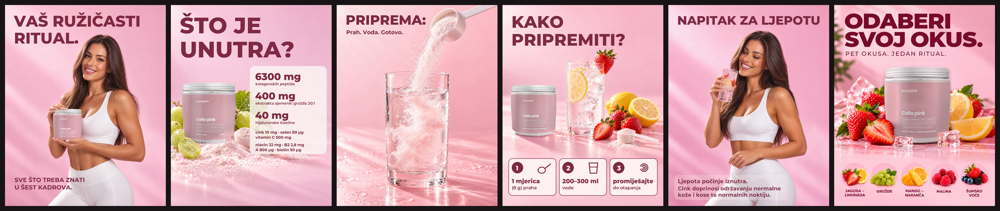
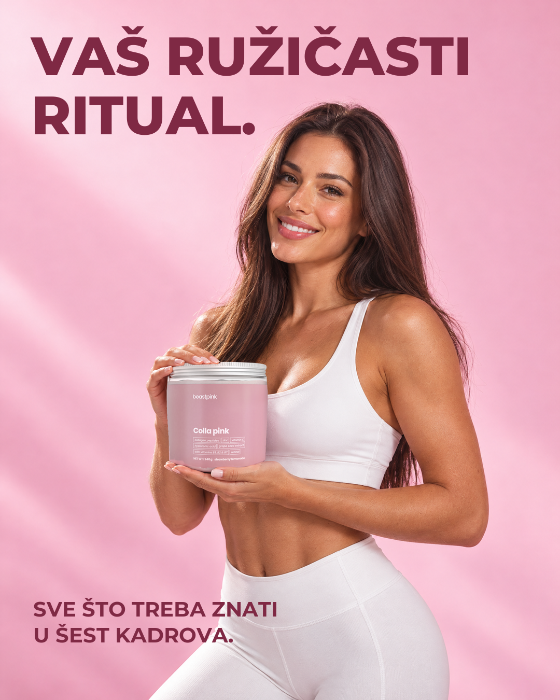
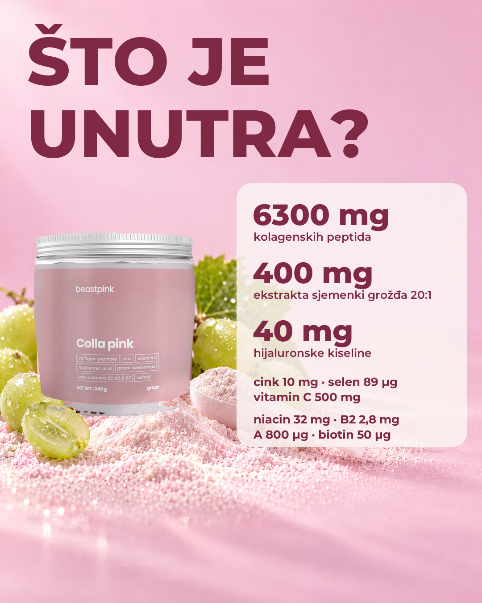
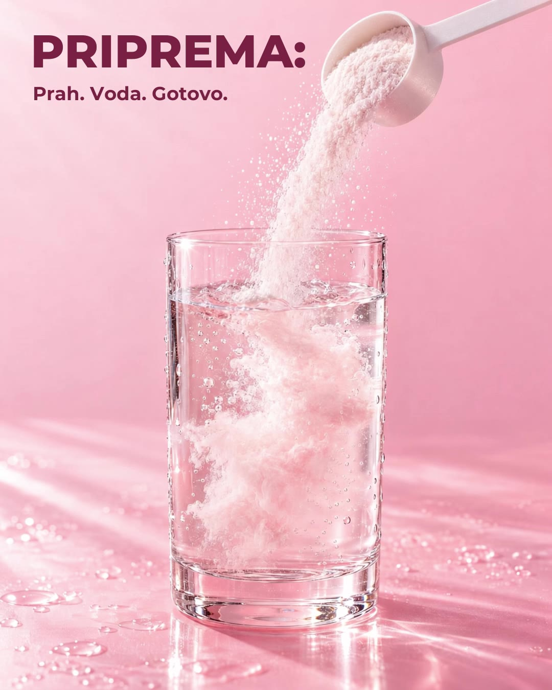
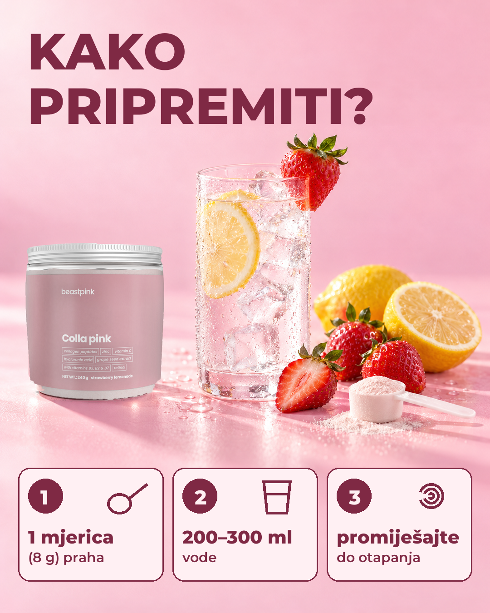
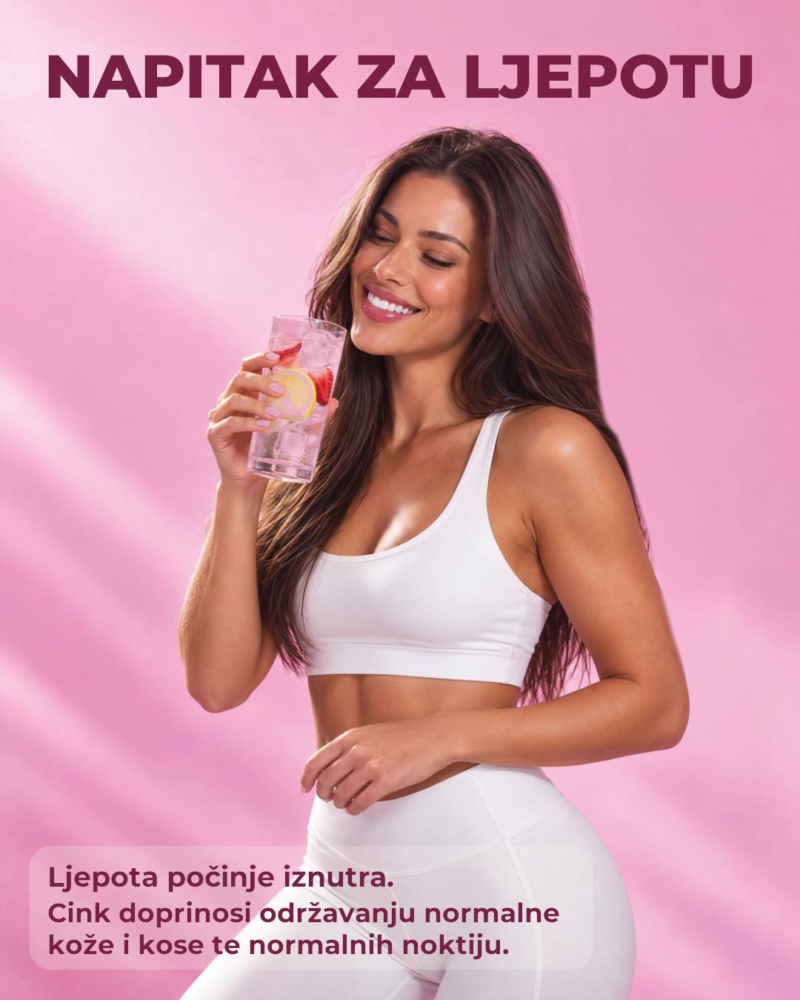
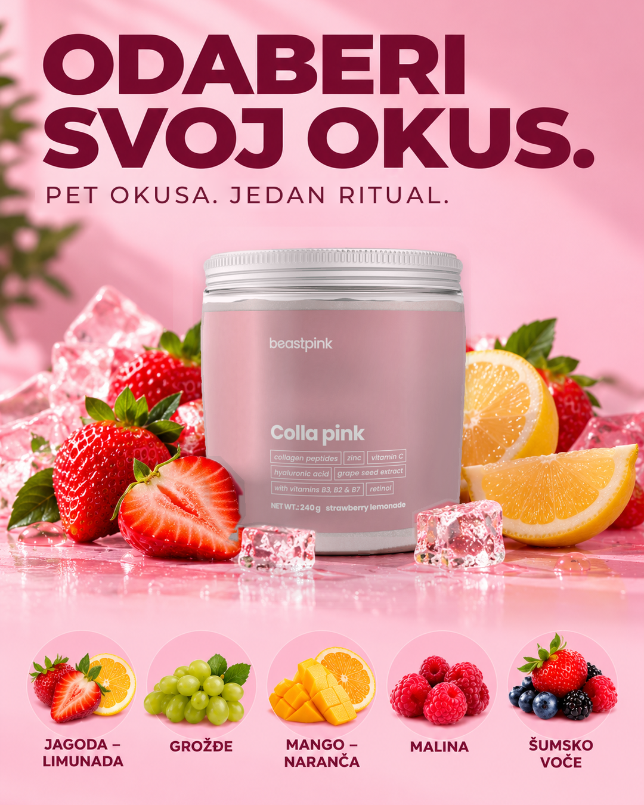

# Objava 2 – BeastPink Colla Pink, karusel „Vaš ružičasti ritual"

6 slajdova u formatu 4:5 (**1080 × 1350 px**): 4 slike (PNG) i 2 videa (MP4, H.264, 24 fps, 5,04 s, bez zvuka).

| # | Slajd | Datoteka | Tekst na slajdu |
|---|---|---|---|
| 1 |  | [`slide-1-cover.png`](slide-1-cover.png) | VAŠ RUŽIČASTI RITUAL. · SVE ŠTO TREBA ZNATI U ŠEST KADROVA. |
| 2 |  | [`slide-2-ingredients.png`](slide-2-ingredients.png) | ŠTO JE UNUTRA? · 6300 mg kolagenskih peptida · 400 mg ekstrakta sjemenki grožđa · 40 mg hijaluronske kiseline · vitamini i minerali |
| 3 ▶ |  | **video:** [`slide-3-preparation.mp4`](slide-3-preparation.mp4) | PRIPREMA: · Prah. Voda. Gotovo. |
| 4 |  | [`slide-4-how-to-prepare.png`](slide-4-how-to-prepare.png) | KAKO PRIPREMITI? · 1 mjerica (8 g) · 200–300 ml vode · promiješajte |
| 5 ▶ |  | **video:** [`slide-5-beauty-drink.mp4`](slide-5-beauty-drink.mp4) | NAPITAK ZA LJEPOTU · Ljepota počinje iznutra. · Cink doprinosi održavanju normalne kože i kose te normalnih noktiju. |
| 6 |  | [`slide-6-flavours.png`](slide-6-flavours.png) | ODABERI SVOJ OKUS. · PET OKUSA. JEDAN RITUAL. · 5 okusa |

▶ = animirani slajd. Sličica je prvi frame finalnog videa. Klik otvara MP4 datoteku; ako se video ne reproducira u pregledniku, koristi *View raw* ili *Download*.

## Što prikazuje
Edukativni lifestyle karusel: što je u napitku, kako se priprema, tvrdnja o cinku i izbor okusa. Vizualni stil je pastelno ružičast, u skladu s brendom BeastPink.

## Kako je nastao
- **Scene:** generirane s `gpt-image-2.5-sunburst`. **Prava teglica** vraćena je kodom sa službene fotografije (matiranje i postavljanje).
- **Slajdovi 3 i 5:** animirani s Kling v4 (image-to-video, fal.ai) iz čistog početnog framea. Tekst je dodan kodom na svaki frame.
- **Završni ispravci** (lokalno, bez plaćenih poziva): na slajdu 3 podnaslov je smanjen da ga žlica ne prekriva. Na slajdu 5 tvrdnja o cinku glasi točno prema Uredbi (EU) 432/2012 (službeni hrvatski tekst). Na slajdu 6 lokalno su retuširana tri artefakta.
- Skripte: [`plans/gymbeam_hr/phase5/`](../../plans/gymbeam_hr/phase5/) · provjera tvrdnji: [`plans/gymbeam_hr/final_revision/`](../../plans/gymbeam_hr/final_revision/)

## Opis (caption)
> Vaš ružičasti ritual uz Colla Pink. 💗 Što je unutra, kako se priprema i koji okus odabrati: prelistajte do kraja. Spremite objavu, a više pogledajte putem poveznice u opisu profila.
> Dodatak prehrani nije zamjena za raznoliku i uravnoteženu prehranu i zdrav način života. Preporučena dnevna doza: 1 mjerica (8 g) u 200–300 ml vode; ne prekoračujte preporučeni dnevni unos. Proizvod nije namijenjen djeci, trudnicama i dojiljama.
> Zamišljeni portfolio oglas: osoba i prizori u objavi generirani su umjetnom inteligencijom. Nije službena suradnja s GymBeamom ni BeastPinkom.
> #gymbeamhr #gbfit #beastpink

*⚠️ Prava objave nisu riješena: dopuštenje nositelja prava za službene fotografije nije pribavljeno. Detalji: [README → Prava na medije](../../README.md#prava-na-medije). SHA-256 svih datoteka: [`showcase/README.md`](../README.md).*
